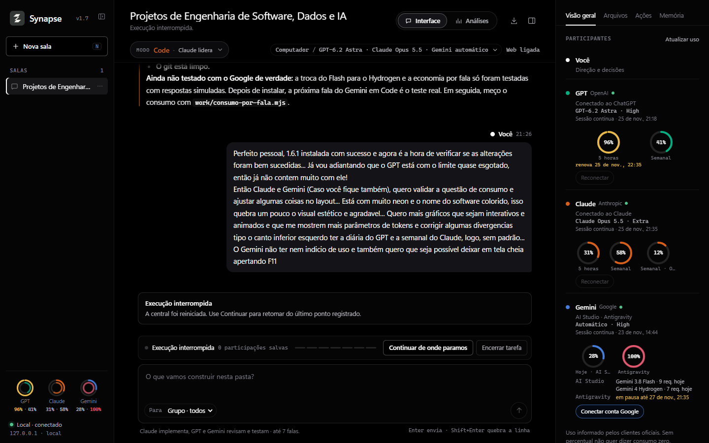
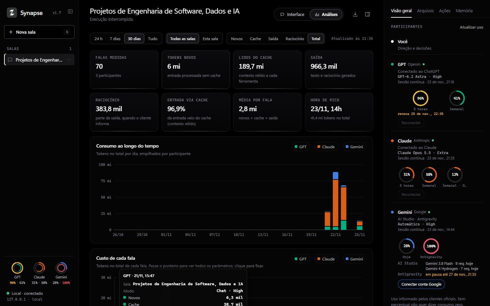
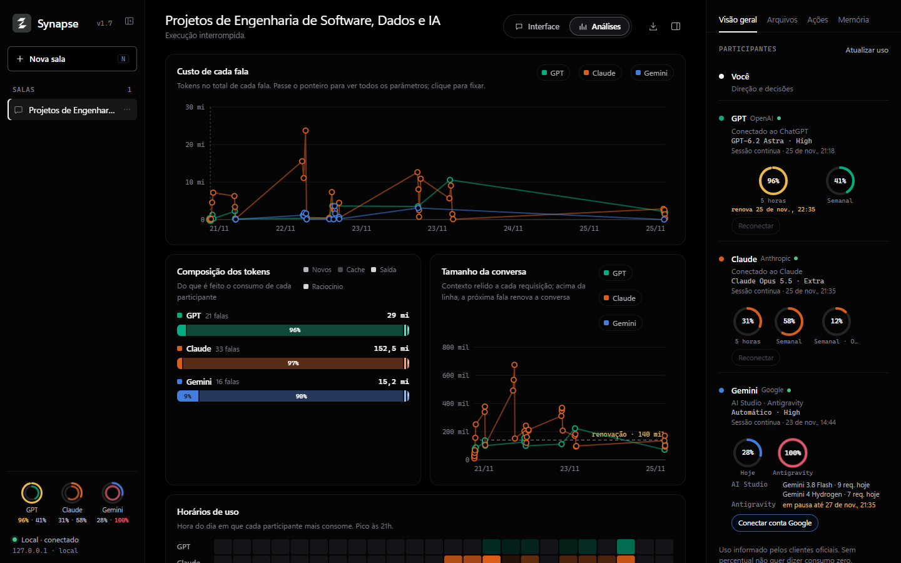
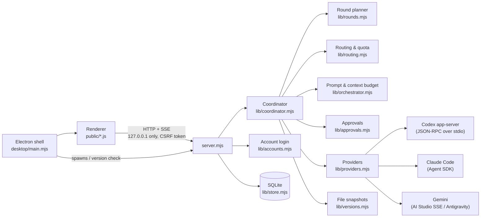

# Synapse

**A Windows desktop app where GPT, Claude and Gemini work together with you in a single project room: they discuss, review each other's work and write code in turns.**



> 🇧🇷 Guia de uso em português: [README.pt-BR.md](README.pt-BR.md)

Synapse doesn't call the models through pay-per-token APIs. It drives each vendor's **official local client** — OpenAI Codex (`app-server` over JSON-RPC), Anthropic Claude Code (Claude Agent SDK) and Google Gemini (AI Studio streaming API or Antigravity) — so every participant keeps its native tools, sign-in and permission model. Synapse's job is coordination: who speaks next, what context each one gets, which actions need a human, and how much each turn costs.

| | |
|---|---|
| **Stack** | Node.js 24 (ES modules, no framework) · Electron 45 · `node:sqlite` · vanilla JS + SVG UI |
| **Size** | ~8.6k lines of application code · 25 test files / 234 tests (`node --test`) |
| **Releases** | 0.x → 1.7.0 in under four weeks (Nov 2026), shipped as an NSIS installer with in-app updates |

## What it does

- **Group rounds.** One participant speaks at a time and reads everything said before. In **Chat** mode the leader proposes, peers critique with evidence and the leader writes the synthesis. In **Code** mode the leader implements and tests, peers review and may patch, and the cycle repeats until a review pass approves the current version.
- **@mentions and replies.** `@Gemini` targets one participant; participants can call each other (capped at 3 calls per round); replying to a selected passage of a message carries that quote as context.
- **Quota-aware routing.** Each turn records the usage the client reports. A participant above a configurable threshold "passes the turn" to a colleague with headroom; one that hits its limit leaves the round, its partial answer is saved, and the next one continues. Unknown usage is never treated as zero.
- **Human-in-the-loop safety.** Agent actions (commands, file writes, tool calls) go through an approval queue. An optional **Autonomy** mode auto-approves routine actions, but a deny-list still always asks: `git push`, `git reset --hard`, recursive deletes, `npm publish`, `gh repo create/delete`, disk formatting, shutdown and registry edits.
- **Token analytics.** An *Analytics* tab normalizes usage across the three clients per turn (fresh input, cache reads, output, reasoning, effort, mode) and charts it in hand-written SVG: usage over time, cost of every turn with a full-parameter tooltip, token composition per participant, conversation size against the renewal threshold, and an hour-of-day heatmap. Legends are clickable and filter the whole tab.
- **Account connection without secrets.** *Connect/Reconnect* runs each vendor's own login flow (Codex `account/login/start`, `claude auth login`, Antigravity OAuth). Synapse only opens the official page, accepts login URLs from an allow-list of vendor hosts, and never sees or stores a password or token.
- **Per-room tool budget.** Each room picks which of the user's MCP servers the agents may load, and a tool-call ceiling per turn (default 80) makes an agent stop calling tools and answer with what it already verified instead of losing the turn.
- **Desktop app.** Electron shell with tray icon, single-instance lock, F11 full screen, local server restart on version change, and "Restart to update" from a watched folder of installers.





## Architecture



A longer module-by-module tour is in [docs/ARCHITECTURE.md](docs/ARCHITECTURE.md).

## Engineering highlights

- **Least privilege by default.** Child agents get a scrubbed environment: API-billing keys, cloud credentials, `NODE_OPTIONS` and parent-agent variables are stripped, so each client uses only its own subscription login (`lib/agents.mjs`). A task that continues can only narrow the access it was granted, never widen it (`narrowSettings` in `lib/coordinator.mjs`).
- **Local-only server.** The HTTP server binds to `127.0.0.1`, rejects foreign `Host`/`Origin` headers, serves a strict Content-Security-Policy and compares a per-session CSRF token in constant time (`timingSafeEqual`).
- **Context budgeting.** History is packed into a character budget, newest first, while keeping the user's newest messages. Resumed sessions get an incremental prompt instead of the full history, which cut prompt size by ~70% on real turns. A conversation is renewed automatically once a participant's context passes 140k tokens.
- **Who changed what.** Before and after each turn Synapse fingerprints the room's files, so in Code mode it knows which reviewer edited which file and makes the leader re-check those edits before closing.
- **Resilient providers.** Streaming timeouts tuned for long reasoning, retries on 503 with a request budget shared across model switches, daily-quota parsing from 429 responses, quota notices detected even when a client returns them as a normal answer, and automatic fallback between Gemini models and transports, always logged in the room's *Actions* panel.
- **Measured, not guessed.** Changes to context handling are checked against real usage exported from the app: for example, the median cache read per Claude turn in Code mode dropped from 8.0M to 2.5M tokens between 1.5 and 1.6 (see the dev log).
- **Regression tests for real incidents.** Many tests are named after bugs seen in daily use: a speech cut short by a status tag, a duplicated MCP server, Gemini stuck outside rounds, context lost on resume.

## Getting started

Requirements: Windows 10/11, Node.js 24+, and the official clients you want in the room (Codex CLI signed in to ChatGPT, Claude Code with a compatible plan, and/or a Gemini API key).

```powershell
npm ci --include=dev
npm test          # 234 tests, no network or accounts needed
npm run app       # opens the desktop app
npm run dist      # builds the NSIS installer into dist/
```

The Gemini key is read from `SYNAPSE_GEMINI_API_KEY` or from the private file `%LOCALAPPDATA%\Synapse\private\.env`. It is sent only in the Google API auth header and is never bundled into the installer. Data lives in `%APPDATA%\Synapse\dados`; set `SYNAPSE_DATA_DIR` to run an isolated instance.

## Project layout

```
server.mjs            HTTP + SSE API, input validation, CSRF, static files
launch.mjs            starts or reuses the local server
lib/                  coordination, providers, rounds, routing, store, approvals, analytics
public/               renderer: chat, rooms, analytics tab (SVG charts), themes
desktop/              Electron main process, preload, updater, installer hooks
tests/                node:test suites + fixtures (fake MCP gateway)
docs/                 architecture notes, development log, screenshots
```

## How it was built

I designed the product, the coordination rules and the safety model, and drove development by running Synapse on itself: each version was planned in a Chat room and implemented, reviewed and tested by GPT, Claude and Gemini in Code rooms, with me approving actions, choosing between proposals and doing hands-on QA on the installed build. The day-by-day record of decisions, measurements and fixes is in [docs/DEVLOG.md](docs/DEVLOG.md) (Portuguese).

## Status and limitations

- Windows-only today (installer, process tree handling, paths).
- Gemini does not report usage percentages, so it can't "pass the turn" by quota.
- Personal project, not affiliated with OpenAI, Anthropic or Google. Each client is used under its own account and terms.
